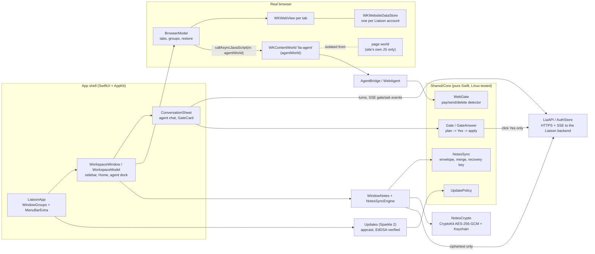

# Liaison for Mac 0.2.x "classic"

SwiftUI + AppKit, WKWebView, Sparkle, end-to-end encrypted notes.

Liaison for Mac 0.2.x was a native macOS workspace built around a real browser, with four AI agents working
beside the person: **Lia** (research and the open web), **Met** (Meta Ads), **Dev** (sites and code) and **Crea**
(creatives). The person signs in to Meta, Google or anything else in the app's own browser. The agents read the page,
prepare changes and ask before anything reaches Meta: every write to an ad account is a plan with a diff, applied
only after a click on **Yes**. In Auto one Yes covers the rest of that task; turning anything on always asks again.

The 0.2.x line shipped 0.2.0 to 0.2.13 through Sparkle between 10 and 23 October 2026. 0.2.14 was the last
build of the line and was never released. After that the product became a messenger with the agents (0.3.0),
which is **not** part of this repository. Product site: [liaisone.com](https://liaisone.com).

This repository is a curated snapshot of the 0.2.14 source, made for code review.

## Architecture



- **Shell.** `App/LiaisonApp.swift` is the SwiftUI entry point. It defines `WindowGroup`s for the main and private
  windows, a `MenuBarExtra` and the menu commands. `App/Workspace/WorkspaceWindow.swift` and
  `WorkspaceModel.swift` hold one workspace: sidebar, Home, the browser and the agents' dock and conversations. AppKit appears
  where SwiftUI falls short: `WKWebView` hosted through `NSViewRepresentable` (`App/Workspace/WebViewHost.swift`), menus (`App/Shell/Menus.swift`, `ContextMenu.swift`), window chrome and glass
  (`WindowChrome.swift`, `App/Workspace/WindowGlass.swift`), the menu bar item (`MenuBarStatus.swift`).
- **Browser.** `App/Browser/BrowserModel.swift` owns tabs, groups, restore and the web views. It has its own
  persistent `WKWebsiteDataStore` per Liaison account (`dataStore(for:)`), never `.default`, so the Liaison session
  never enters the browser and the browser's sign-ins never reach the app. Every script we run goes into a separate
  `WKContentWorld` (`BrowserModel.agentWorld`), never into the page's world. Passwords, extensions, page
  translation and per-site sign-in sharing are next to it in `App/Browser/`.
- **Agents in the browser.** `AgentBridge.swift` reads the page as text in `agentWorld`. `WebAgent.swift` and
  `AgentDirector.swift` run Lia's steps. `Shared/Core/WebAgentCore.swift` (`WebGate`) decides, in Swift and under
  test, whether a press would pay, buy, send, book or delete. If it would, it becomes a question to the person.
  Password, card and code fields are never typed into.
- **Writes to Meta.** `Shared/Core/Modes.swift` has `Gate`, `GateAnswer` and `Gate.digitAnswer`. The backend
  stops a turn on a prepared change. The app shows the diff (`GateCard` in `App/Workspace/ConversationSheet.swift`)
  and applies only on a click (`GateBar` → `TeamChatModel.answer` → `apply` in `App/Workspace/TeamChatModel.swift`).
  In Auto one Yes covers the rest of that task (`task_yes`); turning anything on (`final`) always asks again. In
  this build a typed digit answers nothing (`onDigit` returns false); `Gate.digitAnswer` is the rule for any surface
  that maps digits, and `Tests/ModesTests.swift` proves for every mode that it can never return a write.
- **Notes, end-to-end encrypted.** `App/Workspace/WindowNotes.swift` is the notes panel.
  `App/Workspace/NotesSyncEngine.swift` handles pull, push and conflicts. `Shared/Core/NotesSync.swift` is the pure
  part: the envelope, the recovery key and the merge rules. `App/Workspace/NotesCrypto.swift` holds the CryptoKit
  cipher and the Keychain. The server only ever stores ciphertext.
- **Updates.** `App/Updates.swift` wraps Sparkle's `SPUStandardUpdaterController`. `Shared/Core/UpdatePolicy.swift`
  decides when a downloaded update may install by itself, and when it must wait and ask. The release and signing
  flow is described in [docs/RELEASING.md](docs/RELEASING.md).
- **Backend.** `Shared/API/LiaAPI.swift` (+ extensions) and `Shared/Auth/` are the clients for the Liaison API on
  `*.liaisone.com`: HTTPS and server-sent events, with a session token in the Keychain. The backend is a separate
  code base and is not included here.

## Key decisions

1. **The browser is real and isolated.** The page world stays untouched: our scripts run only in
   `BrowserModel.agentWorld` (`App/Browser/BrowserModel.swift`, `static let agentWorld`). Sites cannot see or
   tamper with the agent's bridge, and the bridge cannot be fooled by a page that overrides DOM globals. Each
   Liaison account gets its own `WKWebsiteDataStore(forIdentifier:)` (`dataStore(for:)`), so two client accounts
   on one Mac never share cookies.
2. **No write without a click.** `Gate.options(mode:)` and `Gate.digitAnswer(_:mode:)` (`Shared/Core/Modes.swift`)
   make "a digit only ever means No" a property of the type, not of a view. `GateAnswer.appliesWrite` is the one
   place that defines which answers send money-moving changes.
3. **The rules are pure Swift, so they run on Linux.** Every rule that can be written without AppKit lives in
   `Shared/Core` with no UI imports: merge rules, gates, update policy, tab strip layout, URL rules, payment-word
   detection. That code is compiled and tested on Linux with a small XCTest shim (`scripts/test-core-linux.sh`).
   The cipher is injected through a protocol (`NotesCipher`), so the crypto format is tested on Linux with a fake
   and on macOS with CryptoKit.
4. **Notes crypto: fixed format, AAD binding, the key in iCloud Keychain.** AES-256-GCM with a fresh 12-byte nonce.
   The AAD is `liaison-notes:v1:<workspace>:<note>`, so a ciphertext moved to another note does not open. The key
   id is the first 8 bytes of SHA-256 over a label plus the key. The recovery key is `LIA1-` + base32 with a
   CRC-16. The Keychain item is updated in place and never deleted and re-added, because deleting a synchronizable
   item removes it on every Mac. See `NotesKeyring.save` in `App/Workspace/NotesCrypto.swift`.
5. **Updates that never interrupt work.** Sparkle downloads silently. `UpdatePolicy.decide` installs only at a
   quiet moment: just launched, just woke, back after 30 minutes, or idle for 15. It installs only when nothing would
   be lost (`AppBusy`: no agent run, no pending Yes, no unsent text). Otherwise the update waits behind a banner.
   Dev builds carry no feed and no key, so they never check (`Updates.configured`).

## Running the checks (Linux, no Xcode)

```sh
bash scripts/linux-swift-setup.sh            # Swift 5.10 toolchain into /tmp/swiftdl, no root
export LD_LIBRARY_PATH=/tmp/swiftdl/icu/usr/lib/x86_64-linux-gnu PATH=/tmp/swiftdl/root/usr/libexec/swift/bin:$PATH
bash scripts/check-escapes.sh                # doubled-backslash lint + `swiftc -parse` of every Swift file
bash scripts/test-core-linux.sh              # Shared/Core + 90 test files, compiled and run on Linux
```

Last run on this extract: `escapes ok`, `parse ok`, and `core tests: 943 run, 0 failed`. That checks syntax and
pure logic only. SwiftUI and AppKit code is parsed but **not compiled** here. `NotesCryptoTests` and `AuthTests`
(3 tests) need macOS (CryptoKit, URLSession async).

## Stack

Swift 5 (language mode), SwiftUI + AppKit, macOS 14+. WebKit (`WKWebView`, `WKWebsiteDataStore(forIdentifier:)`,
`WKContentWorld`), CryptoKit, Security (Keychain, iCloud Keychain), Translation (weak-linked), Sparkle 2 (SPM),
XcodeGen (`project.yml`), Developer ID signing + notarization. The tests are XCTest, plus a small shim for Linux.

## What this extract is (and is not)

This is a curated extract. It keeps the shell, the browser, the agent panel and conversation views, Sparkle
updates, the encrypted notes, the write gate, all of `Shared/Core`, and the Linux-runnable tests.

Left out:
- the pre-workspace screens
- sign-in and settings UI
- the Crea and Dev studio views, onboarding and the tour
- chat blocks and popups
- fonts, third-party brand logos and other assets
- the release script, internal docs and the landing site
- screenshots: the source keeps no 0.2.x UI screenshots, only mockups of the later messenger

Some included files therefore refer to types that are not here. Comments name the web client's functions
(`ai.js`, `shell.js`, `settings.js`) and the backend workers (`lia-agents`, `meta-mcp`) that the Mac code was
ported from or talks to; that code is not here.

The app builds in Xcode on macOS once signing is set up (a Developer ID team in `Config/Local.xcconfig`, plus a
provisioning profile for iCloud Keychain). This repository is not compiled in CI. Identifiers were replaced with
placeholders: the Apple Team ID (`XXXXXXXXXX`), the Memberstack public key, the update host
(`updates.example.com`), plan ids, and customer and people's names in test fixtures. The Sparkle public key and feed URL are empty build
settings in `Config/Shared.xcconfig` and are set only by a release build.

## Naming

- **Liaison**: the product. **Lia, Met, Dev, Crea**: the four agents (research and web, Meta Ads, code and sites,
  creatives).
- **Workspace**: one client or project, with its own browser tabs, agents' history and notes.
- **Gate**: a prepared change the person must answer (Yes / Yes to all / No). **Plan**: the server-side prepared
  write that a Yes applies. **Journal**: the record of applied writes, which allows Undo.
- **agentWorld**: the `WKContentWorld` our scripts run in, separate from the page's own JavaScript.
- **kid**: the notes key's public fingerprint. **Recovery key**: the `LIA1-...` string that restores the notes key
  on a new Mac.
- **"Classic"**: the 0.2.x browser-centred app, as opposed to the 0.3.0 messenger that replaced it.

## License

Source available for review only. See [LICENSE](LICENSE) and [THIRD_PARTY_NOTICES.md](THIRD_PARTY_NOTICES.md).
